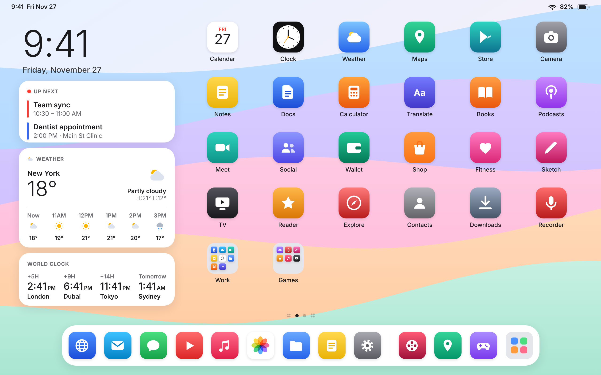

# TabLauncher

A clean, English-only Android home screen (launcher) for tablets, designed for the Lenovo Legion Y900.



## Features

- **Home Screen** – big clock + widgets column, app grid with folders, solid dock with your recent apps
- **App Library** – every app sorted into categories automatically (no dock on this page)
- **Widgets page** (swipe right) – Google search bar, weather, calendar, **live scores** (football, cricket, NBA, NFL…),
  **Google News** headlines, and any Android widget you add (Google, Gmail, YouTube Music…)
- **Swipe down search** – apps, Google suggestions, Play Store, calculator, website and Settings shortcuts
- **Customize** – long-press an empty spot on the Home Screen:
  - Wallpaper: built-in designs or your own photos (kept at full resolution), separate wallpaper for light and dark mode,
    also applied to the **Lock screen**
  - Layout: rows & columns for landscape and portrait, widgets on Home, recent apps in Dock, App Library side
  - Icons: shape (squircle, rounded, circle, square, teardrop), size, style (normal, dark, tinted), labels
  - Fonts: Inter, Poppins, Nunito, Outfit, Manrope, Quicksand, Lora or system, plus clock thickness
  - Widgets: weather city, °C/°F, sports leagues, news country, world-clock cities
  - More: swipe-down action, hidden apps, set as default Home app
- **Drag & drop** – long-press an app and move it; drop it on another app to make a folder, or onto the dock
- No glass / blur effects – solid, clean cards in light and dark themes

## Install on your tablet

1. Open the **[Releases](https://github.com/sherazi5110/TabLauncher/releases)** page on the tablet.
2. Download the newest `TabLauncher-1.0.x.apk` and open it (allow "Install unknown apps" for your browser if asked).
3. Open TabLauncher and tap **Set** on the banner (or Settings → Apps → Default apps → Home app → TabLauncher).

Every build is signed with the same key, so **new versions install as an update** over the old one and keep your layout
and settings — no need to uninstall.

Each push to `main` builds a new release automatically (GitHub Actions → *Build APK*).

## Adding your own wallpapers

Long-press the Home Screen → **Wallpaper** → choose *Light mode* or *Dark mode* → **Add photo**. The photo is copied
byte-for-byte, so it keeps its full resolution. Turn on **Use on Lock screen too** to set the same picture on the lock screen.

## Notes for ZUI (Lenovo)

- The Recents screen and system gesture navigation belong to Lenovo's own launcher; no other launcher can replace them.
  If gestures stop working after switching, use the 3-button navigation bar.
- Live scores use ESPN's public scoreboard feeds; weather uses Open-Meteo; news uses Google News RSS (English editions).

## Build it yourself

```bash
./gradlew assembleRelease
```

The APK is written to `app/build/outputs/apk/release/`. Design plan and mockups: [docs/DESIGN.md](docs/DESIGN.md).
