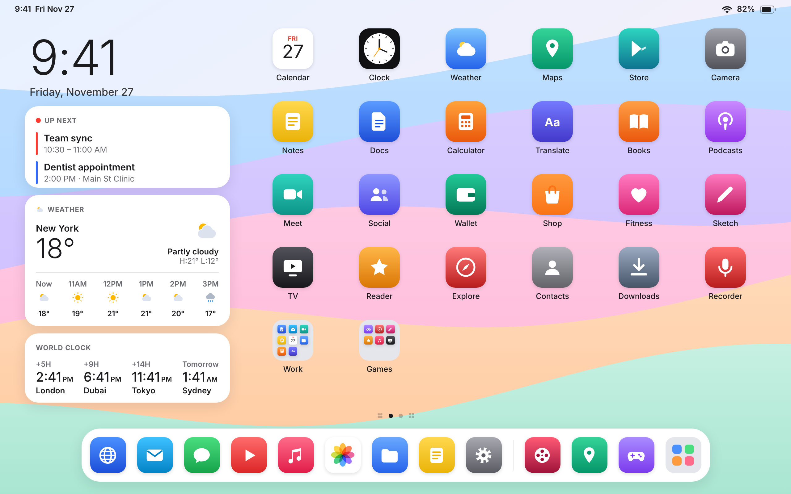
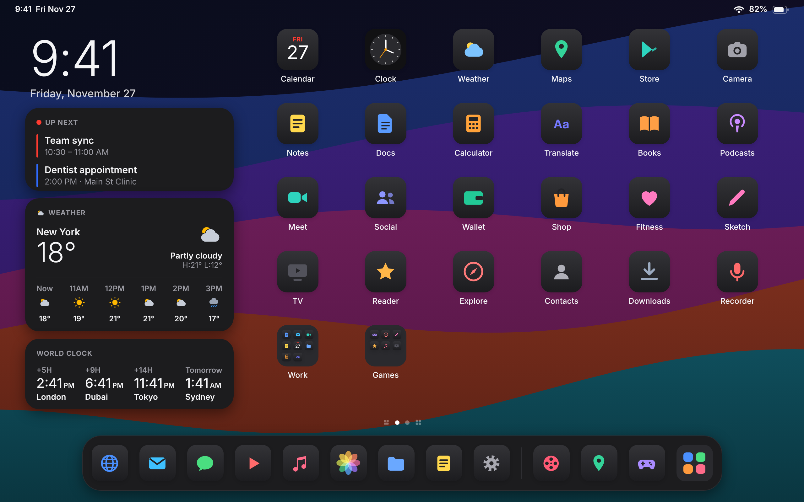
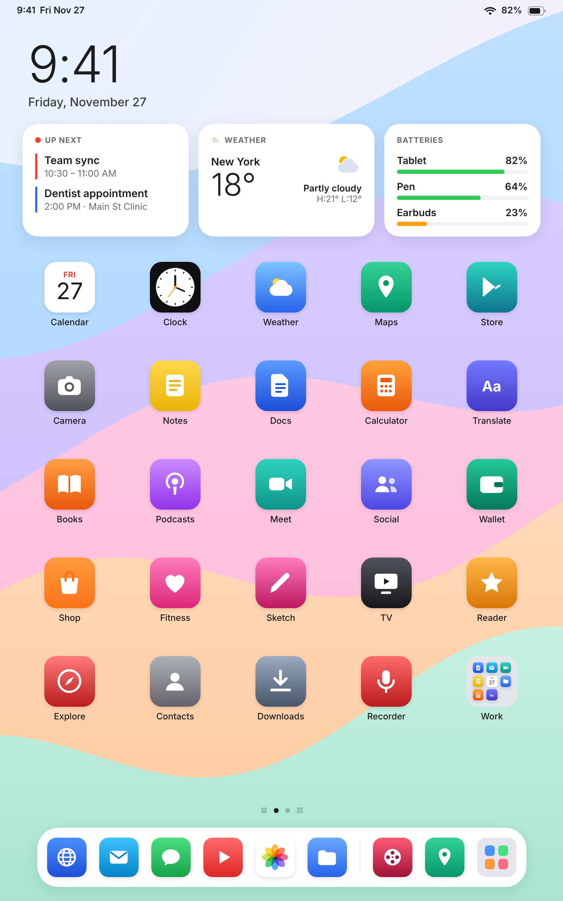
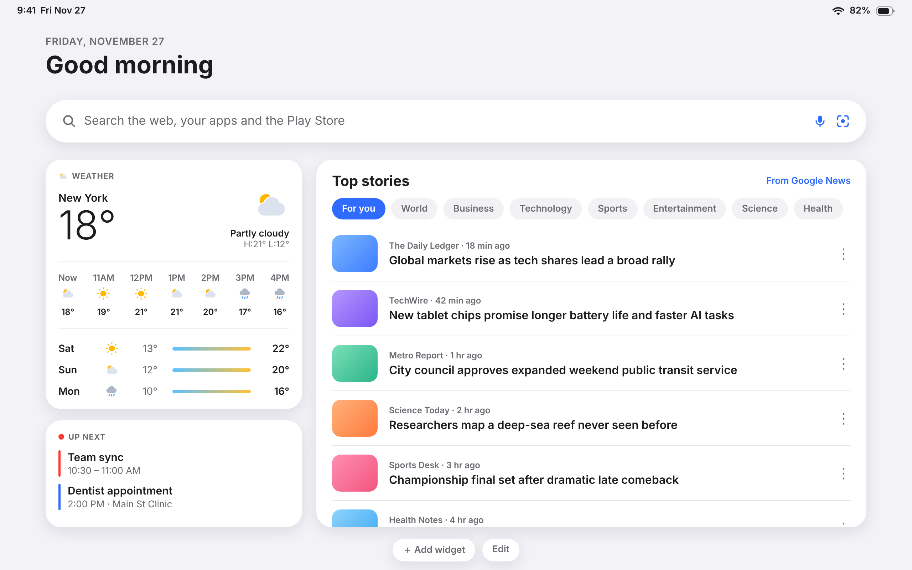
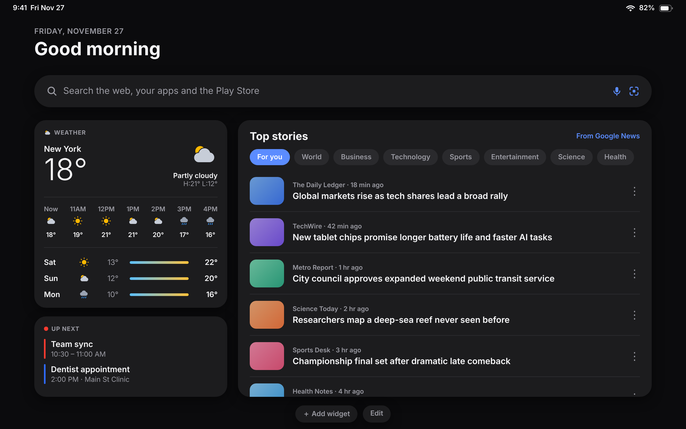
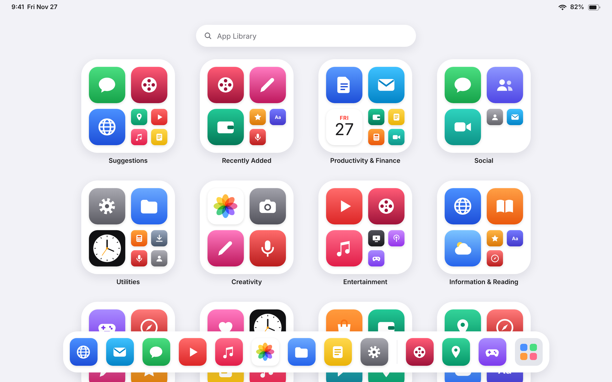
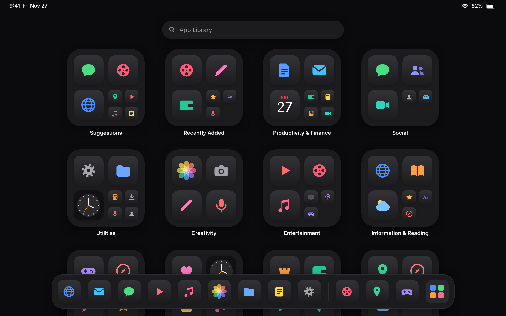
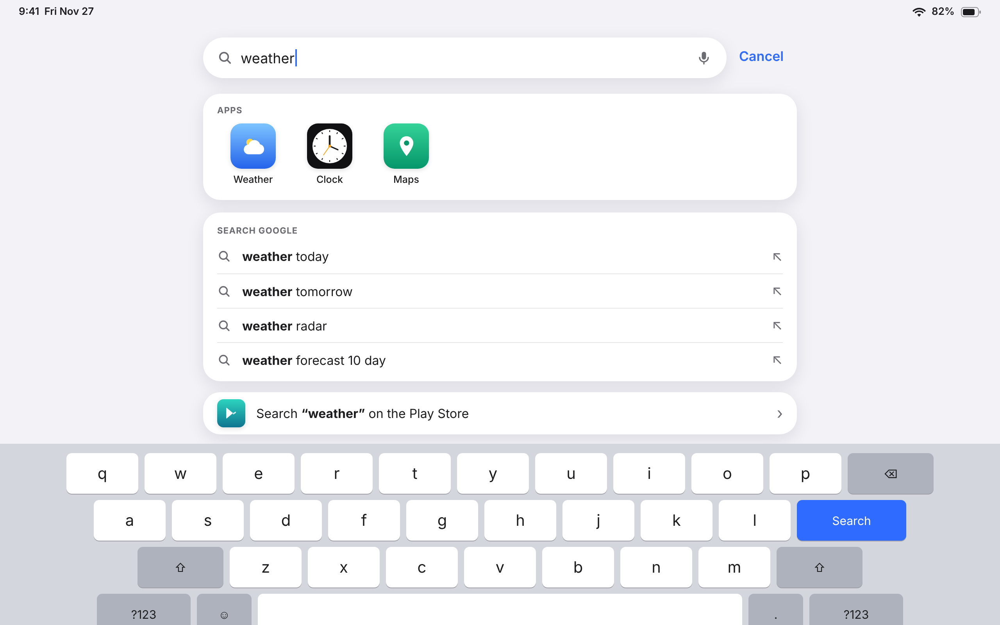

# TabLauncher — Design Plan

A clean, English-only home screen for the **Lenovo Legion Y900** tablet (works on any Android 8+ tablet).
Layout inspired by tablet home screens: widgets on the left, a big app grid, a dock at the bottom and an
App Library page. **No glass / blur effects** — every surface is a solid card with a soft shadow.

> The app icons in these mockups are placeholders. On your tablet the launcher shows your real app icons.

---

## 1. Home Screen

- **Left column:** big clock + date, then a stack of widgets (Up Next, Weather, World Clock, Batteries, or any Android widget you add).
- **Right side:** app grid (default 6 × 5 in landscape). Folders show a 3 × 3 preview of the apps inside.
- **Page dots:** the first dot is the Widgets page, the last one is the App Library.
- **Dock (bottom):** solid white (light) / dark-grey (dark) bar.
  - Left part: your pinned apps (up to ~10 in landscape).
  - After the divider: the 3 apps you opened most recently.
  - Last button: opens the App Library.

### Dark theme

- Dark wallpaper, dark widget cards and **dark app icons** (the icon's colour moves to the symbol, background turns dark grey).
- Theme can follow the system (auto light/dark) or be fixed to Light or Dark.
- You pick a separate wallpaper for Light and for Dark mode (built-in designs or your own photo).

### Portrait

In portrait the widgets move to a row across the top and the grid becomes 5 columns.

---

## 2. Widgets page (swipe right from Home — like the Pixel "left screen")

- Greeting + date.
- **Search bar** (opens search; mic = voice search, the camera button opens Google Lens if installed).
- **Weather** with hourly and 3-day forecast (free Open-Meteo service, no account needed).
- **Up Next** from your calendar.
- **Top stories** from **Google News** in English, with topic tabs (World, Business, Technology, Sports…).
  You choose the country/edition in Settings.
- **+ Add widget / Edit:** add any Android widget (Google, Gmail, Calendar, YouTube Music…), reorder, resize or remove.

> Note: Google's own "Discover" feed can only be shown inside launchers Google has approved, so this page
> uses Google News headlines + any Google widgets you add instead.

---

## 3. App Library (swipe left past your last Home page)

- Search bar at the top: tap and type to get an A–Z list of all apps.
- Apps are **automatically grouped** into category boxes: Suggestions, Recently Added, Productivity & Finance,
  Social, Utilities, Creativity, Entertainment, Information & Reading, Games, Health & Fitness, Shopping & Food, Travel.
- Each box shows 3 big icons (tap to open) and a cluster of small icons (tap to open the whole category).
- Long-press any app: Add to Home Screen, Add to Dock, Hide app, App info, Uninstall.
- The positions of Widgets page and App Library can be swapped in Settings.

---

## 4. Search (swipe down anywhere on Home)

- Opens instantly with the keyboard.
- **Apps** that match what you type (first result opens with the keyboard's Search key).
- **Google suggestions** as you type (tap to search on Google, ↖ to copy into the box).
- **Play Store**: "Search … on the Play Store" opens the Play Store results directly.
- Also: simple calculator (type `25*4`), open websites (type `youtube.com`), quick Settings shortcuts (Wi-Fi, Bluetooth, Display…).

---

## 5. Gestures & editing

| Action | Result |
| --- | --- |
| Swipe left / right | Change page (Widgets ← Home pages → App Library) |
| Swipe down on Home | Search (can be changed to "open notifications") |
| Swipe up on Home | App Library |
| Tap an app | Open it |
| Long-press an app | Menu: app shortcuts, Edit Home Screen, Remove, App info, Uninstall |
| Long-press + drag | Move apps, drop on another app to make a folder, drop on the dock |
| Long-press empty space | Edit mode (icons wiggle, add widgets, open Settings) |
| Home button | Go back to the first Home page |

## 6. Settings

- **Appearance:** Theme (System / Light / Dark), icon style (Auto / Always light / Always dark / Tinted single colour),
  Light & Dark wallpaper, option to also apply the wallpaper to the lock screen.
- **Home screen:** columns & rows (landscape and portrait), icon size, show/hide labels, show widgets on Home,
  add newly installed apps to Home, show recent apps in Dock.
- **Pages:** App Library on right (default) or left.
- **Gestures:** swipe-down action.
- **Widgets:** weather city & °C/°F, Google News edition (US, UK, India, Pakistan, Canada, Australia, UAE…), world-clock cities.
- **Apps:** hide apps.
- **Set as default Home app** button.
- 100 % English — the launcher never shows Chinese text (app names come from your apps themselves).

## 7. How it's built

- Kotlin + Jetpack Compose, minimum Android 8.0, target Android 15.
- Uses official Android launcher APIs (`LauncherApps`, `AppWidgetHost`), so it works on ZUI without root.
- GitHub Actions builds the APK on every push → download it from the **Releases** page and install.

### Limits on ZUI (Lenovo's system)
- The **Recent apps** screen and system navigation gestures belong to Lenovo's launcher and cannot be replaced
  by any third-party launcher. On some ZUI versions gesture navigation only works with Lenovo's launcher —
  if so, use the 3-button navigation bar.

## 8. Build order

1. Project setup + GitHub Actions APK builds.
2. Home grid, dock, wallpapers, light/dark theme & icon styles.
3. App Library + search.
4. Widgets page (weather, calendar, news, Android widgets).
5. Drag & drop, folders, edit mode.
6. Settings screen.
